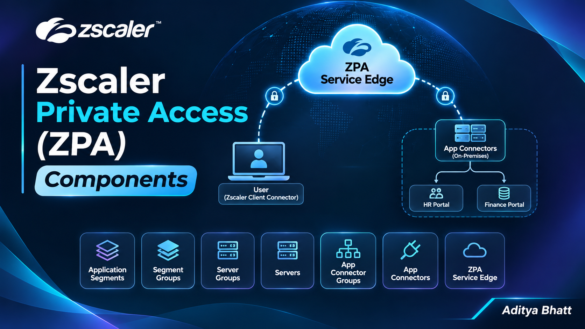

# Zscaler Private Access ZPA Components

**ZPA | Zero Trust | Private Application Access | Architecture | Policy Engineering**

A practical technical reference exploring Zscaler Private Access (ZPA), its architecture, core components, application segmentation, connector infrastructure, access policies, enterprise deployment scenarios, and end-to-end traffic flows.

 <br/>

---

## Table of Contents

1. [Introduction to ZPA](#1-introduction-to-zpa)
2. [Understanding Zero Trust Architecture](#2-understanding-zero-trust-architecture)
3. [Enterprise Infrastructure: Acme Corp](#3-enterprise-infrastructure-acme-corp)
4. [Core ZPA Architecture Components](#4-core-zpa-architecture-components)
   - Application Segments
   - Segment Groups
   - Server Groups
   - Servers
   - App Connector Groups
   - App Connectors
   - ZPA Service Edge
5. [Understanding Component Relationships](#5-understanding-component-relationships)
6. [End-to-End Traffic Flow](#6-end-to-end-traffic-flow)
7. [Understanding the Two Secure Connections](#7-understanding-the-two-secure-connections)
8. [Enterprise Access Scenarios](#8-enterprise-access-scenarios)
9. [Access Policy Engineering](#9-access-policy-engineering)
10. [High Availability and Resilience](#10-high-availability-and-resilience)
11. [Security Architecture and Design Considerations](#11-security-architecture-and-design-considerations)
12. [Troubleshooting and Failure Scenarios](#12-troubleshooting-and-failure-scenarios)
13. [ZPA vs Traditional VPN](#13-zpa-vs-traditional-vpn)
14. [Technical and Scenario-Based Questions](#14-technical-and-scenario-based-questions)
15. [Key Takeaways](#15-key-takeaways)

---

# 1. Introduction to ZPA

**Zscaler Private Access (ZPA)** is a Zero Trust Network Access (ZTNA) solution that provides secure, identity-based access to private applications without requiring those applications to be directly exposed to the public internet.

Unlike traditional VPN architectures, ZPA focuses on connecting authenticated users to specific applications rather than granting broad access to an internal network.

### Why ZPA?

Traditional remote-access architectures often provide users with network-level connectivity. This can introduce unnecessary exposure and increase the attack surface.

ZPA follows an application-centric approach:

- Users access only the applications they are authorized to use.
- Application access is governed by identity and policy.
- Private applications remain inaccessible through direct public internet exposure.
- App Connectors establish outbound connections to the ZPA cloud.
- Access can be provided without exposing inbound application ports to the internet.

### Core Concept

**Connect users to applications, not networks.**

---

# 2. Understanding Zero Trust Architecture

Zero Trust follows the principle:

**Never trust, always verify.**

Access should not be granted merely because a user is connected to a corporate network.

Instead, access decisions consider relevant identity, application, device, and contextual information according to the configured policies.

### Core principles

| Principle | Explanation |
|---|---|
| Explicit verification | Authenticate and authorize access using relevant identity and contextual signals |
| Least privilege | Provide only the access required |
| Assume breach | Design systems with the assumption that compromise is possible |
| Application-level access | Restrict access to authorized applications |
| Continuous protection | Apply security controls throughout the access lifecycle |

ZPA implements these principles through its private application access architecture and access policies.

---

# 3. Enterprise Infrastructure: Acme Corp

To understand ZPA practically, consider a fictional organization called **Acme Corp**.

Acme has an on-premises data centre hosting multiple internal applications.

Employees need remote access to these applications without exposing the internal infrastructure directly to the internet.

### 3.1 Infrastructure overview

**Acme Corp — On-Premises Data Centre**

| Component | Hostname | Private IP | Port |
|---|---|---|---|
| HR Portal | hr.acme.local | 10.10.10.20 | TCP 443 |
| Finance Portal | finance.acme.local | 10.10.10.30 | TCP 443 |
| App Connector 1 | AC-Connector-01 | 10.10.10.5 | Outbound connectivity |
| App Connector 2 | AC-Connector-02 | 10.10.10.6 | Outbound connectivity |

**App Connector Group:** `OnPrem-ACG`

Both App Connectors can communicate with the internal application servers.

The App Connectors are deployed within Acme's private network, close to the applications they need to access.

They are not application servers themselves. They provide secure connectivity between the ZPA cloud and the private application infrastructure.

*All hostnames, IP addresses, and infrastructure details in this example are fictional.*

### 3.2 Example users

| User | Department | Required Access |
|---|---|---|
| John | HR | HR Portal |
| Alice | Finance | Finance Portal |
| Bob | IT | HR and Finance Portals |

This allows us to demonstrate identity-based application access.

---

# 4. Core ZPA Architecture Components

Understanding the individual components is essential before studying the complete architecture.

## 4.1 Application Segments

**Purpose: Define which private applications ZPA should protect.**

An Application Segment represents a private application or application access definition.

It specifies the application destination information, such as:

- Application domain or IP address.
- Application ports.
- Protocols.
- Associated segment group.
- Associated server group and other relevant configuration.

### Example

Acme wants to protect two applications.

| Application Segment | Domain | Port |
|---|---|---|
| HR-App | hr.acme.local | TCP 443 |
| Finance-App | finance.acme.local | TCP 443 |

When John attempts to access:

`https://hr.acme.local`

ZPA can identify the request as traffic destined for a configured private application.

**Important:** An Application Segment does not represent the actual server. It defines the application access parameters.

## 4.2 Segment Groups

**Purpose: Logically organise Application Segments.**

Imagine Acme has 100 internal applications.

Managing individual application definitions in every relevant configuration can become difficult.

Segment Groups provide a logical way to organise Application Segments.

### Example

Create:

`Corporate-Apps`

Add:

- HR-App
- Finance-App

Now both application definitions belong to the same logical group.

This makes it easier to organise applications and reference them in relevant configuration workflows.

Segment Groups do not represent physical infrastructure.

## 4.3 Server Groups

**Purpose: Associate application backend destinations with suitable App Connector infrastructure.**

A Server Group defines the backend server association used by ZPA.

For Acme, create:

`OnPrem-Servers`

Associate it with:

- App Connector Group: OnPrem-ACG
- HR backend server
- Finance backend server

This allows ZPA to identify suitable connector infrastructure for reaching the application destinations.

## 4.4 Servers

**Purpose: Represent the actual backend destinations.**

These are the machines hosting the internal applications.

| Server | Private IP | Application |
|---|---|---|
| HR01 | 10.10.10.20 | HR Portal |
| FIN01 | 10.10.10.30 | Finance Portal |

The Server configuration represents the backend destination information used by ZPA.

The actual applications continue running on their respective internal servers.

## 4.5 App Connector Groups

**Purpose: Logically group deployed App Connectors.**

An App Connector Group is a logical grouping of App Connector instances.

Example:

`OnPrem-ACG`

Members:

- AC-Connector-01
- AC-Connector-02

Grouping connectors helps with infrastructure organisation, availability, and application connectivity management.

## 4.6 App Connectors

**Purpose: Provide secure connectivity between ZPA and private applications.**

An App Connector is the software component deployed within the organisation's private environment.

It establishes outbound secure connectivity to the ZPA cloud.

When an authorized user requests access to a private application, the App Connector receives the relevant connection traffic through its established connection and communicates with the backend application.

### Important characteristics

- Deployed within the private network.
- Initiates outbound connectivity to ZPA.
- Does not require direct inbound internet access to the private application.
- Communicates with internal application servers.
- Can operate as part of an App Connector Group.
- Multiple connectors can provide resilience.

## 4.7 ZPA Service Edge

**Purpose: Provide the cloud-side coordination and policy enforcement infrastructure.**

The ZPA Service Edge is a central part of the ZPA architecture.

It participates in:

- User connection handling.
- Access policy evaluation.
- Application access coordination.
- Secure connectivity between the user side and application side.

It enables authorized users to access private applications through the ZPA architecture.

---

# 5. Understanding Component Relationships

The most important distinction is that these objects do not form one rigid four-level hierarchy.

They are separate configuration objects with associations.

### Acme Corp configuration

**Application Segments**

- HR-App
- Finance-App

**Segment Group**

- Corporate-Apps
  - HR-App
  - Finance-App

**Server Group**

- OnPrem-Servers
  - Associated backend server destinations
  - Associated App Connector Group

**App Connector Group**

- OnPrem-ACG
  - AC-Connector-01
  - AC-Connector-02

**Servers**

- HR01 — 10.10.10.20
- FIN01 — 10.10.10.30

### Mental model

| Component | Primary Question |
|---|---|
| Application Segment | What application are we protecting? |
| Segment Group | How are application definitions organised? |
| Server Group | Which connector infrastructure can reach the backend? |
| Server | Where is the application hosted? |
| App Connector Group | Which App Connectors are logically grouped? |
| App Connector | Which component provides connectivity to the private network? |
| ZPA Service Edge | Where are access decisions and connection coordination handled? |

---

# 6. End-to-End Traffic Flow

Now consider John, an Acme employee, working from home.

He opens his browser and enters:

`https://hr.acme.local`

Let's follow the request.

### Step 1: User device — Zscaler Client Connector

John's laptop runs Zscaler Client Connector (ZCC).

When John requests:

`hr.acme.local:443`

ZCC identifies the destination as a configured private application and handles the traffic according to the applicable configuration.

### Step 2: ZPA Service Edge

ZCC establishes secure connectivity to the ZPA Service Edge.

The Service Edge participates in evaluating the access request against relevant policies.

The request involves information such as:

- User identity.
- Requested application.
- Application access definition.
- Applicable access policy.
- Relevant contextual conditions.

### Step 3: App Connector selection

After access is authorized, ZPA identifies suitable App Connector infrastructure capable of reaching the requested application.

In our example:

`OnPrem-ACG`

ZPA can use an available, suitable connector instance within the configured infrastructure.

### Step 4: App Connector to HR server

The App Connector receives the relevant traffic over its established secure connection to ZPA.

It then establishes connectivity to:

`10.10.10.20:443`

The request reaches the HR Portal inside Acme's private network.

### Step 5: HR server processes the request

The HR server receives the request and processes it.

The application generates the response.

### Step 6: Response travels back to the user

The response returns through the App Connector and the established ZPA connectivity path.

It reaches John's Zscaler Client Connector and subsequently the requesting application on his device.

**Result:** John accesses the HR Portal without requiring the portal to be directly exposed to the public internet.

---

# 7. Understanding the Two Secure Connections

This is one of the most important architectural concepts in ZPA.

The architecture involves two independently established outbound connections.

### Connection 1: User Device → ZPA Service Edge

- Zscaler Client Connector runs on the user's device.
- It establishes secure connectivity to the ZPA Service Edge.
- It handles traffic destined for authorized private applications.

### Connection 2: App Connector → ZPA Service Edge

- App Connector runs within Acme's private network.
- It independently establishes outbound secure connectivity to the ZPA Service Edge.
- It maintains connectivity so that application requests can be delivered through the ZPA architecture.

### Simplified architecture

```text
          ACME EMPLOYEE
                |
                |
        User's Laptop
                |
     Zscaler Client Connector
                |
                |
       Secure Connection 1
                |
                v
       +------------------+
       |                  |
       |   ZPA SERVICE    |
       |      EDGE        |
       |                  |
       +------------------+
                ^
                |
       Secure Connection 2
                |
                |
         App Connector
                |
         OnPrem-ACG
                |
                |
       Internal Network
                |
                v
        +---------------+
        |   HR SERVER   |
        | 10.10.10.20  |
        +---------------+
```

### Why is this important?

The App Connector initiates its connection outward to Zscaler.

The company does not need to open an inbound internet-facing port directly to its internal HR application to facilitate this architecture.

The ZPA Service Edge coordinates the two sides.

**Remember:** The App Connector is not simply a proxy exposed to the internet. It is part of a cloud-coordinated private application connectivity architecture.

---

# 8. Enterprise Access Scenarios

Let's extend the Acme Corp example.

## Scenario A: HR employee accessing HR Portal

John belongs to the HR department.

He attempts to access:

`hr.acme.local`

Expected result:

- User authenticates.
- ZPA identifies the requested application.
- Access policy evaluates John's identity and application access.
- Access is permitted.
- Traffic reaches the HR backend through suitable App Connector infrastructure.

## Scenario B: HR employee attempting to access Finance Portal

John attempts:

`finance.acme.local`

Expected result:

- The application is identified.
- The applicable access policy is evaluated.
- If John is not authorized for Finance, access is denied.

Even though the Finance application exists in the same private environment, this does not automatically grant John access.

## Scenario C: IT administrator accessing both applications

Bob belongs to the IT department.

He needs access to both applications for administrative purposes.

An appropriately configured policy can authorize Bob for:

- HR Portal.
- Finance Portal.

The access decision remains governed by the relevant identity and policy configuration.

---

# 9. Access Policy Engineering

Access Policies determine which users can access which private applications under configured conditions.

For Acme Corp, consider the following conceptual policy design.

| Policy | User Group | Application | Action |
|---|---|---|---|
| HR-Access | HR | HR-App | Allow |
| Finance-Access | Finance | Finance-App | Allow |
| IT-Access | IT | Corporate-Apps | Allow |

### Example policy logic

```text
IF
    User belongs to HR
AND
    Requested application is HR-App

THEN
    ALLOW ACCESS
```

Another example:

```text
IF
    User belongs to Finance
AND
    Requested application is Finance-App

THEN
    ALLOW ACCESS
```

### Important considerations

- Use least-privilege access.
- Avoid unnecessarily broad application access.
- Keep application definitions organised.
- Review access policies periodically.
- Consider user identity and relevant contextual conditions.
- Validate policy ordering and precedence according to the configured policy model.

---

# 10. High Availability and Resilience

Consider the Acme environment again.

It has two App Connectors:

- AC-Connector-01 — 10.10.10.5
- AC-Connector-02 — 10.10.10.6

Both belong to:

`OnPrem-ACG`

Both can reach the HR and Finance servers.

### What happens if Connector 1 fails?

Suppose:

`AC-Connector-01` becomes unavailable.

If Connector 2 is healthy, suitable for the application, and has the required network connectivity, ZPA can use it to provide application connectivity.

This helps maintain availability.

### Why deploy multiple connectors?

- Redundancy.
- Improved resilience.
- Reduced dependency on one connector.
- Support for maintenance and recovery.
- Better availability across supported deployment designs.

**Important:** Connector redundancy alone does not guarantee application availability. Backend health, network reachability, connector capacity, and the overall deployment design also matter.

---

# 11. Security Architecture and Design Considerations

A secure ZPA deployment requires more than simply deploying App Connectors.

Consider the following:

| Area | Consideration |
|---|---|
| Identity | Use appropriate identity and authentication controls |
| Application segmentation | Define specific application destinations and ports |
| Least privilege | Restrict users to required applications |
| Connector security | Harden and maintain App Connector infrastructure |
| Network security | Permit required outbound connectivity and internal backend access |
| Availability | Deploy suitable redundant connector infrastructure |
| Monitoring | Monitor connector health and application connectivity |
| Policy management | Review and validate access policies regularly |

### Important architectural principle

Private applications should not require direct public exposure simply to support remote employee access.

ZPA provides a controlled application access architecture through its cloud and connector infrastructure.

---

# 12. Troubleshooting and Failure Scenarios

Understanding the architecture makes troubleshooting significantly easier.

### Scenario 1: User cannot access HR Portal

Potential investigation areas:

- Is Zscaler Client Connector running?
- Is the user authenticated?
- Is the application configured correctly?
- Does the user satisfy the relevant access policy?
- Can the App Connector reach the backend?
- Is the HR application listening on TCP 443?
- Is DNS resolution working as expected?

### Scenario 2: App Connector is unhealthy

Investigate:

- Connector service health.
- VM resource utilisation.
- Outbound connectivity.
- DNS and network configuration.
- Required connectivity to ZPA.
- Connector registration and provisioning status.

### Scenario 3: Application resolves but does not load

Possible causes:

- Incorrect application port configuration.
- Backend service unavailable.
- Firewall restrictions.
- Connector-to-server connectivity issues.
- Application-specific TLS or certificate issues.
- Incorrect DNS resolution.

### Scenario 4: One connector fails

Investigate:

- Whether another suitable connector is available.
- Connector Group health.
- Backend reachability from the alternate connector.
- Application availability.
- Connector capacity and deployment configuration.

### Troubleshooting principle

Always isolate the issue into three broad areas:

1. **User side:** Device, Client Connector, authentication and DNS.
2. **Cloud side:** Application definition, policy evaluation and service connectivity.
3. **Private infrastructure side:** App Connector, internal network and backend application.

---

# 13. ZPA vs Traditional VPN

| Feature | Traditional VPN | ZPA |
|---|---|---|
| Access approach | Commonly network-level | Application-level |
| Access control | Network-oriented | Identity and application-oriented |
| Private application exposure | Depends on VPN architecture | No direct public application exposure required |
| Remote access | VPN tunnel | ZPA cloud-coordinated connectivity |
| Least privilege | Requires network and access configuration | Application-specific access policies |
| Connector infrastructure | VPN gateways | App Connectors |
| Access decisions | VPN and network controls | ZPA access policies |

ZPA and traditional VPNs solve remote-access problems using different architectural approaches.

ZPA is designed around Zero Trust application access rather than broad network connectivity.

---

# 14. Technical and Scenario-Based Questions

## Q1. Does an App Connector receive inbound connections directly from the internet?

No. App Connectors initiate outbound secure connections to the ZPA cloud. The architecture does not require direct inbound internet connectivity to the private application.

## Q2. Is an App Connector the same as an App Connector Group?

No.

An App Connector is the actual deployed software component.

An App Connector Group is the logical grouping of App Connector instances.

## Q3. Does ZPA expose the internal application's IP to the internet?

ZPA does not require the private application to be publicly exposed. The internal application remains within the private environment.

## Q4. What happens if one App Connector goes down?

Another healthy and suitable App Connector may provide connectivity, provided the deployment and backend network configuration support it.

## Q5. Is ZPA a traditional VPN?

No. Traditional VPNs commonly provide network-level access, whereas ZPA provides controlled access to specific private applications.

## Q6. Does the App Connector make the access decision?

No. Access policy enforcement is handled by ZPA's cloud-side architecture. The App Connector provides connectivity to the private application.

## Q7. Can multiple Application Segments use the same Server Group?

Yes, where the application and infrastructure configuration supports it. Shared backend connector infrastructure can serve multiple application definitions.

## Q8. Why do we need Segment Groups?

They provide logical organisation of Application Segments and simplify configuration management.

## Q9. What is the difference between a Server and a Server Group?

A Server represents a backend destination.

A Server Group associates backend server destinations with suitable App Connector infrastructure.

## Q10. Why does the App Connector initiate outbound connections?

This enables private application connectivity without requiring the organisation to expose inbound access to its private network.

## Q11. What happens when a user is authorized but the backend application is unavailable?

Authorization does not guarantee application availability. The connection can still fail because of backend, DNS, firewall, routing, or application-service issues.

## Q12. Can an employee access every application simply because they are connected to ZPA?

No. Access is governed by the applicable application definitions and authorization policies.

---

# 15. Key Takeaways

| Component | Remember |
|---|---|
| Application Segment | Defines the private application access parameters |
| Segment Group | Organises Application Segments |
| Server Group | Associates backend destinations with connector infrastructure |
| Server | Represents the backend application destination |
| App Connector Group | Groups App Connector instances |
| App Connector | Establishes connectivity to private applications |
| ZPA Service Edge | Handles cloud-side policy enforcement and connection coordination |
| Zscaler Client Connector | Provides the user-side connectivity component |

### The one mental model to remember

**Application Segment:** What application are we protecting?

**Segment Group:** How are we grouping application definitions?

**Server Group:** Which connector infrastructure can reach the backend?

**Servers:** Where is the application hosted?

**App Connector Group:** Which connectors are grouped together?

**App Connector:** Which component connects Zscaler to the private network?

**ZPA Service Edge:** Where does cloud-side access enforcement and connection coordination happen?

---

## Repository Philosophy

This repository is an independently developed technical reference built around fictional enterprise infrastructure and original explanatory examples.

Its objective is to make ZPA architecture easier to understand through:

- Practical enterprise scenarios.
- Component-level explanations.
- Architecture and traffic-flow diagrams.
- Configuration relationships.
- Access policy examples.
- Troubleshooting scenarios.
- Technical and interview preparation.

All company names, infrastructure details, hostnames, IP addresses, and user identities used in examples are illustrative.

**Author:** Aditya Bhatt

**Focus:** Zero Trust | Zscaler Private Access | Enterprise Security | Network Architecture | Security Engineering

---
